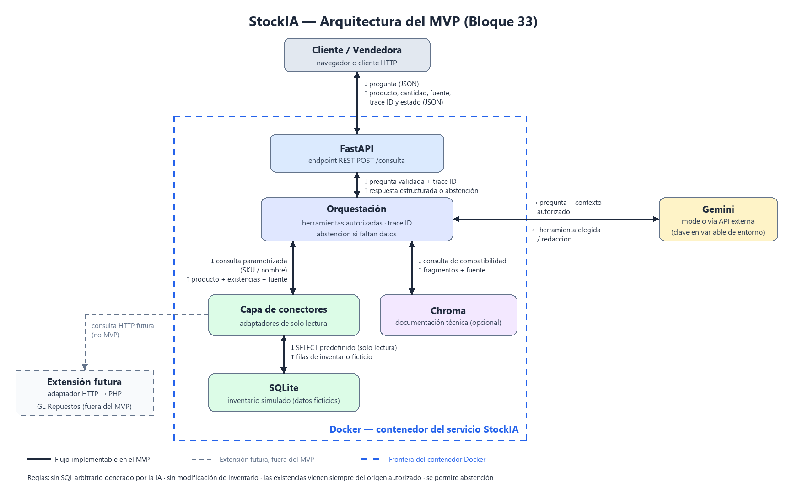

# Ficha de diseño funcional — StockIA

> Proyecto: StockIA, consulta de inventarios para microempresas.
> Caso de referencia: GL Repuestos (repuestos y accesorios para motocicletas).
> Estado: secciones 1 a 3 completas en el Bloque 33; secciones 4 y 5 redactadas en el Bloque 34, pendientes de revisión cruzada (docs/revision_alcance.md).

## 1. Problema de negocio

**Quién tiene el problema.** En GL Repuestos, empresa que comercializa repuestos y accesorios para motocicletas, las vendedoras atienden a clientes que preguntan por productos concretos. Cuando no conocen un producto, su disponibilidad o su compatibilidad con un modelo de motocicleta, deben interrumpir al responsable del inventario para obtener la respuesta.

**Qué sucede.** Cada duda se resuelve de forma manual y depende de una sola persona. Mientras el responsable del inventario responde, deja de hacer su propio trabajo, y el cliente espera en el mostrador o en la conversación. Si el responsable no está disponible, la venta se retrasa o la información entregada puede ser imprecisa.

**Cuánto tiempo requiere.** Estimación preliminar, a partir de lo informado por el negocio:

| Variable | Mínimo | Intermedio | Máximo |
|---|---|---|---|
| Consultas diarias | 10 | 15 | 20 |
| Minutos por consulta | 5 | 7,5 | 10 |
| Días mensuales (supuesto de cálculo) | 22 | 22 | 22 |
| Consultas mensuales | 220 | 330 | 440 |
| Tiempo mensual dedicado | 18 h 20 min | 41 h 15 min | 73 h 20 min |

Los 22 días mensuales son solo un supuesto de cálculo. Estas cifras son estimaciones preliminares, no mediciones instrumentadas; deberán contrastarse con un registro real de consultas.

**Qué mejora se espera.** El objetivo preliminar es reducir al menos un 50 % del tiempo dedicado a responder estas consultas, sujeto a validación posterior. En el escenario intermedio, esto equivale a liberar al menos 20 h 37 min mensuales del responsable del inventario y a que las vendedoras obtengan respuestas sobre producto, disponibilidad y compatibilidad sin depender de su presencia.

## 2. Requerimientos y alcance (MVP)

### Requerimientos funcionales

| ID | Requerimiento |
|---|---|
| RF-01 | Recibir una pregunta de inventario mediante API REST y devolver la respuesta en JSON. |
| RF-02 | Buscar productos por SKU, nombre o descripción. |
| RF-03 | Consultar cantidades disponibles mediante un conector autorizado de solo lectura. |
| RF-04 | Entregar una respuesta que identifique el producto, la cantidad y la fuente, o una abstención explícita cuando falten datos. |
| RF-05 | Consultar compatibilidades respaldadas por documentación. |
| RF-06 | Integrar un inventario externo mediante conector HTTP/PHP. |
| RF-07 | Modificar existencias o registrar movimientos. |
| RF-08 | Integrar WhatsApp. |

### Requerimientos no funcionales

| ID | Requerimiento | Criterio medible |
|---|---|---|
| RNF-01 | Tiempo de respuesta | Al menos 9 de 10 consultas DEMO se responden en 5 segundos o menos. |
| RNF-02 | Exactitud de cantidades | Las cantidades coinciden con la fuente simulada en 20 de 20 casos de referencia. |
| RNF-03 | Privacidad de logs | 0 de 20 consultas de prueba dejan credenciales, preguntas completas o información sensible en logs. |
| RNF-04 | Facilidad de despliegue | El servicio se inicia siguiendo el README y Docker en un máximo de 10 minutos en el entorno de prueba definido. |
| RNF-05 | Trazabilidad | 20 de 20 consultas de prueba (100 %) devuelven trace ID y estado. |

### Clasificación del alcance

Imprescindible: RF-01, RF-02, RF-03, RF-04
Deseable: RF-05, RF-06
Fuera de alcance: RF-07, RF-08

**Motivos.**

- **Imprescindibles (RF-01 a RF-04).** Forman el flujo mínimo que resuelve el problema de la sección 1: la vendedora pregunta (RF-01), el servicio encuentra el producto (RF-02), obtiene la cantidad desde un origen autorizado (RF-03) y responde citando la fuente o se abstiene (RF-04). Si falta cualquiera de los cuatro, el MVP no responde una consulta de disponibilidad de forma verificable. Son 4 imprescindibles, dentro del máximo de 5.
- **Deseables (RF-05, RF-06).** Aportan valor, pero no son necesarios para responder disponibilidad. Las compatibilidades (RF-05) requieren documentación técnica curada y pueden incorporarse con Chroma si sobra tiempo. El conector HTTP/PHP (RF-06) demuestra la arquitectura de adaptadores, pero el MVP ya funciona con el conector SQLite.
- **Fuera de alcance (RF-07, RF-08).** Modificar existencias (RF-07) contradice la regla de solo lectura y exige controles de autorización y auditoría que no caben en el presupuesto. WhatsApp (RF-08) requiere cuentas, credenciales y un canal productivo de terceros; además, el presupuesto de alcance rechaza toda funcionalidad que dependa de sistemas reales.

**Separación entre integración simulada y acceso real.** Si se aborda RF-06 dentro del curso, se hará exclusivamente contra un servicio HTTP de prueba con datos ficticios que imite la forma de la respuesta PHP. Cualquier acceso real al inventario de GL Repuestos queda fuera del MVP y del Gate: no se requieren credenciales, datos de producción ni sistemas productivos para evaluar el proyecto.

## 3. Arquitectura de la solución

Diagrama: docs/diagrama_arquitectura.png

### Decisiones de arquitectura

| # | Decisión | Elección | Justificación |
|---|---|---|---|
| 1 | Modelo | Gemini mediante API | Modelo definido por el curso; se consume como servicio externo, sin infraestructura propia de inferencia. Interpreta la pregunta y redacta la respuesta, pero nunca es la fuente de las cantidades. La clave se lee de una variable de entorno y nunca se guarda en Git. |
| 2 | Vector store | Chroma (opcional) | Solo para documentación técnica (fichas y compatibilidades, RF-05). Funciona embebido dentro del mismo contenedor, sin servidor adicional. Las existencias no se guardan en Chroma, porque cambian y deben leerse siempre del origen autorizado. |
| 3 | Orquestación | Herramientas de consulta autorizadas y componentes reutilizables del Gate 2 | La Orquestación decide qué herramienta invocar (buscar producto, consultar existencias, buscar documentación) a partir de una lista cerrada. Reutilizar componentes del Gate 2 reduce horas y riesgo. Asigna el trace ID y aplica la abstención. |
| 4 | Exposición | FastAPI con endpoint REST | Cumple RF-01 con un endpoint `POST /consulta` que devuelve JSON validado. Facilita pruebas automatizadas y documentación OpenAPI sin trabajo adicional. |
| 5 | Empaquetado | Docker | Un único contenedor reproducible que cumple RNF-04 (inicio en 10 minutos o menos siguiendo el README) y aísla dependencias del entorno de la persona evaluadora. |

### Fuentes de datos y capa de conectores

- **Conector inicial: SQLite con datos ficticios.** El inventario del MVP es una base SQLite generada con productos, SKU y cantidades inventadas. No se usan datos reales de producción de GL Repuestos.
- **Arquitectura de adaptadores.** La Orquestación no conoce el origen concreto: llama a una interfaz común de la capa de conectores (por ejemplo `buscar_producto(texto)` y `consultar_existencias(sku)`). Cada fuente implementa esa interfaz como un adaptador, de modo que agregar una nueva fuente no cambia la Orquestación ni FastAPI.
- **Posible adaptador HTTP para PHP de GL Repuestos (fuera del MVP).** Se representa en el diagrama como extensión futura, con línea discontinua. En el curso solo podría probarse contra un servicio simulado (RF-06, deseable).

### Reglas de seguridad y de datos

- **Ninguna ejecución de SQL arbitrario generado por la IA.** El modelo solo elige una herramienta y sus parámetros; los conectores ejecutan consultas predefinidas y parametrizadas.
- **Ninguna modificación de inventario.** Todos los conectores son de solo lectura; no existe herramienta de escritura (RF-07 fuera de alcance).
- **Las existencias provienen siempre del origen autorizado.** La cantidad que se entrega es la que devuelve el conector, con su fuente; el modelo no la estima ni la recuerda.
- **El modelo puede abstenerse.** Si no hay información suficiente (producto no encontrado, ambigüedad o fuente sin datos), la respuesta indica la abstención con su estado y trace ID, en lugar de inventar.
- **Logs sin datos sensibles.** Se registran trace ID, estado y tiempos; no credenciales ni preguntas completas (RNF-03).

## 4. Criterios de aceptación

Los criterios son objetivos que se validarán durante la construcción. Cada uno indica una entrada reproducible y un resultado observable, y referencia entre paréntesis los requerimientos de la sección 2 que comprueba.

### Contrato observable de `POST /consulta`

Los criterios se expresan sobre el endpoint definido en la decisión 4 de la sección 3. Una respuesta de consulta es un JSON con estos campos:

- `estado`: `respondida`, `abstencion` o `error_validacion`.
- `trace_id`: identificador de seguimiento, texto no vacío y único por consulta.
- `respuesta`: texto para la vendedora.
- `producto`: objeto con `sku` y `nombre`, o `null`.
- `cantidad`: entero mayor o igual a 0, o `null`.
- `fuente`: identificador del origen de la cantidad, o `null`.

### Datos de prueba ficticios

El inventario simulado contiene exactamente estos 20 productos inventados. No corresponden a productos ni existencias reales de GL Repuestos. El SKU `DEMO-999` no existe y se usa como caso negativo.

| SKU | Nombre | Descripción | Existencias |
|---|---|---|---|
| DEMO-001 | Filtro de aceite FA-150 | Filtro de aceite de papel para motor de 150 cc | 12 |
| DEMO-002 | Pastillas de freno delanteras PF-110 | Juego de pastillas orgánicas para freno de disco delantero | 0 |
| DEMO-003 | Cadena de transmisión 428H | Cadena reforzada de 120 eslabones para motos de 125 a 150 cc | 5 |
| DEMO-004 | Bujía estándar BJ-8 | Bujía de electrodo de níquel con rosca de 14 mm | 40 |
| DEMO-005 | Filtro de aire FAI-125 | Elemento filtrante de espuma para caja de admisión de 125 cc | 7 |
| DEMO-006 | Kit de arrastre KA-150 | Conjunto de piñón, corona y cadena para transmisión final | 3 |
| DEMO-007 | Cable de embrague CE-200 | Cable de acero con funda para palanca de embrague | 15 |
| DEMO-008 | Manilla de freno MF-01 | Palanca de aluminio para freno delantero del lado derecho | 9 |
| DEMO-009 | Espejo retrovisor ER-10 | Espejo redondo con brazo cromado y rosca de 10 mm | 22 |
| DEMO-010 | Neumático trasero NT-90 | Cubierta 90/90-18 con dibujo mixto para calle y tierra | 4 |
| DEMO-011 | Cámara de aire CA-18 | Cámara de caucho butílico para aro de 18 pulgadas | 11 |
| DEMO-012 | Batería sellada BS-7 | Batería de 12 V y 7 Ah libre de mantenimiento | 6 |
| DEMO-013 | Ampolleta de foco AF-35 | Lámpara halógena H4 de 35 W para faro delantero | 18 |
| DEMO-014 | Disco de freno DF-220 | Disco perforado de acero inoxidable de 220 mm | 2 |
| DEMO-015 | Amortiguador trasero AT-320 | Amortiguador hidráulico de 320 mm con resorte regulable | 1 |
| DEMO-016 | Retén de horquilla RH-31 | Par de sellos de goma para barras de suspensión de 31 mm | 14 |
| DEMO-017 | Puño acelerador PA-22 | Tubo de plástico con goma para manillar de 22 mm | 8 |
| DEMO-018 | Aceite de motor AM-20W50 | Lubricante mineral 20W-50 de 1 litro para motor de 4 tiempos | 30 |
| DEMO-019 | Correa de distribución CD-80 | Correa dentada de 80 dientes para scooter automático | 10 |
| DEMO-020 | Kit de empaquetaduras KE-150 | Juego completo de juntas para culata y cilindro de 150 cc | 5 |

### Criterios

- CA-01 (RF-01): Enviar `POST /consulta` con el cuerpo `{"pregunta": "¿Cuántas unidades hay del SKU DEMO-001?"}` devuelve HTTP 200, cabecera `Content-Type: application/json` y un cuerpo con los 6 campos del contrato: `estado`, `trace_id`, `respuesta`, `producto`, `cantidad` y `fuente`.
- CA-02 (RF-01): Enviar `POST /consulta` con el cuerpo `{"pregunta": ""}` devuelve HTTP 422, `estado = "error_validacion"`, un `trace_id` no vacío y `cantidad = null`, sin consultar el inventario.
- CA-03 (RF-01): Enviar `POST /consulta` con un cuerpo sin el campo `pregunta` (`{"texto": "DEMO-001"}`) y, en otra petición, con una `pregunta` de 501 caracteres devuelve HTTP 422 y `estado = "error_validacion"` en los 2 casos.
- CA-04 (RF-02): Enviar `{"pregunta": "¿Hay stock del SKU DEMO-003?"}` devuelve `estado = "respondida"`, `producto.sku = "DEMO-003"` y `cantidad = 5`.
- CA-05 (RF-02): Búsqueda por descripción: enviar `{"pregunta": "¿Tienen una cadena reforzada de 120 eslabones?"}`, que no incluye el SKU ni el nombre del producto, devuelve `estado = "respondida"` y `producto.sku = "DEMO-003"`.
- CA-06 (RF-02): Búsqueda por nombre: enviar `{"pregunta": "¿Cuántas unidades quedan de Filtro de aceite FA-150?"}` devuelve `estado = "respondida"` y `producto.sku = "DEMO-001"`.
- CA-07 (RF-02, RF-04): SKU inexistente: enviar `{"pregunta": "¿Cuántas unidades hay del SKU DEMO-999?"}` devuelve HTTP 200, `estado = "abstencion"`, `producto = null`, `cantidad = null`, `fuente = null` y una `respuesta` que indica que el SKU DEMO-999 no se encontró.
- CA-08 (RF-03): Enviar `{"pregunta": "¿Cuántas unidades hay del SKU DEMO-001?"}` devuelve `producto.sku = "DEMO-001"`, `cantidad = 12` y `fuente = "inventario_simulado"`, el identificador del conector de solo lectura.
- CA-09 (RF-03, RF-04): Producto sin existencias: enviar `{"pregunta": "¿Hay stock del SKU DEMO-002?"}` devuelve `estado = "respondida"`, `producto.sku = "DEMO-002"`, `cantidad = 0` (no `null` ni abstención) y una `respuesta` que contiene el texto "0 unidades".
- CA-10 (RF-03): Tras ejecutar las 20 consultas de CA-15, las existencias de los 20 productos del inventario simulado son idénticas a las de la tabla de datos de prueba (0 diferencias en la comparación antes/después), y el esquema `/openapi.json` expone 0 operaciones `PUT`, `PATCH` o `DELETE`.
- CA-11 (RF-04): Enviar `{"pregunta": "¿Cuántas unidades hay del SKU DEMO-004?"}` devuelve `producto.sku = "DEMO-004"`, `producto.nombre = "Bujía estándar BJ-8"`, `cantidad = 40`, una `fuente` no vacía y una `respuesta` que contiene el número 40 y el nombre del producto.
- CA-12 (RF-04): Consulta sin información suficiente: enviar `{"pregunta": "¿Tienen repuestos?"}` (sin producto identificable) y, en otra petición, `{"pregunta": "¿Cuántos filtros hay?"}` (coincide con DEMO-001 y DEMO-005) devuelve en los 2 casos `estado = "abstencion"`, `cantidad = null` y una `respuesta` que pide precisar el SKU, el nombre o la descripción.
- CA-13 (RF-04, RNF-02): No inventa cantidades: en las 3 consultas con abstención de CA-07 y CA-12 se obtiene `cantidad = null` y una `respuesta` sin ninguna cifra seguida de "unidad" o "unidades". Si la prueba modifica el inventario simulado para que DEMO-001 tenga 7 existencias, la consulta de CA-08 devuelve en `cantidad` el valor 7, no 12.
- CA-14 (RNF-01): Enviar de forma secuencial, en el entorno de prueba, las 10 preguntas "¿Cuántas unidades hay del SKU DEMO-0NN?" para DEMO-001 a DEMO-010, midiendo el tiempo desde el envío hasta la recepción completa: al menos 9 de las 10 respuestas llegan en 5 segundos o menos.
- CA-15 (RNF-02): Enviar las 20 preguntas "¿Cuántas unidades hay del SKU DEMO-0NN?" para DEMO-001 a DEMO-020 devuelve, en 20 de 20 casos, `estado = "respondida"` y un valor de `cantidad` igual a la columna Existencias de la tabla de datos de prueba.
- CA-16 (RNF-03): Ejecutar las 20 consultas de CA-15 con la variable de entorno `GEMINI_API_KEY` fijada al valor ficticio `clave-ficticia-de-prueba` y capturar todos los logs del servicio: aparecen 0 veces el valor de la clave y 0 veces el texto completo de cualquiera de las 20 preguntas, y cada una de las 20 consultas deja al menos 1 línea de log con su `trace_id` y su `estado`.
- CA-17 (RNF-04): Partiendo de un clon limpio del repositorio y siguiendo solo los pasos del README, construir la imagen, iniciar el contenedor y enviar la consulta de CA-01 tarda 10 minutos o menos (cronometrado) en el entorno de prueba definido, y esa consulta devuelve HTTP 200.
- CA-18 (RNF-05): Las 20 respuestas de CA-15 incluyen, en 20 de 20 casos, un `trace_id` no vacío y un `estado` válido, y los 20 valores de `trace_id` son distintos entre sí.
- CA-19 (RNF-05): Las respuestas de los casos negativos de CA-02, CA-03, CA-07 y CA-12 (6 peticiones) incluyen también un `trace_id` no vacío y un `estado` válido en 6 de 6 casos.

## 5. Plan de construcción por hitos

Presupuesto aprobado: 20 h disponibles, de las cuales 10 h son de construcción (H1 a H4), 6 h de pruebas, documentación y defensa (H5) y 4 h de margen de imprevistos. Las horas de construcción son las horas ajustadas por novedad que calcula `presupuesto_alcance.py`.

- H1 (3 h): API REST con el endpoint `POST /consulta`, validación de entrada, contrato JSON y asignación de trace ID. Cubre: RF-01, RNF-05. Se comprueba con: CA-01, CA-02, CA-03, CA-18, CA-19.
- H2 (1,5 h): Búsqueda de productos por SKU, nombre o descripción sobre el inventario simulado con los datos de prueba ficticios. Cubre: RF-02. Se comprueba con: CA-04, CA-05, CA-06, CA-07.
- H3 (2 h): Consulta de existencias mediante un conector de solo lectura con consultas predefinidas y parametrizadas. Cubre: RF-03, RNF-02. Se comprueba con: CA-08, CA-09, CA-10, CA-15.
- H4 (3,5 h): Respuestas verificables con producto, cantidad y fuente o abstención, logs sin datos sensibles y empaquetado Docker. Desglose: respuestas verificables 2 h y empaquetado Docker 1,5 h. Cubre: RF-04, RNF-01, RNF-03, RNF-04. Se comprueba con: CA-07, CA-11, CA-12, CA-13, CA-14, CA-16, CA-17.
- H5 (6 h): Pruebas de aceptación de todos los criterios, documentación, instalación limpia y preparación de la defensa. Cubre: RF-01, RF-02, RF-03, RF-04, RNF-01, RNF-02, RNF-03, RNF-04, RNF-05. Se comprueba con: CA-01, CA-02, CA-03, CA-04, CA-05, CA-06, CA-07, CA-08, CA-09, CA-10, CA-11, CA-12, CA-13, CA-14, CA-15, CA-16, CA-17, CA-18, CA-19.

Total planificado: 16 h (10 h de construcción y 6 h de pruebas, documentación y defensa). Margen de imprevistos sin asignar: 4 h. Los deseables RF-05 y RF-06 solo se abordarán si sobra margen al cerrar H4; RF-07 y RF-08 siguen fuera de alcance.
